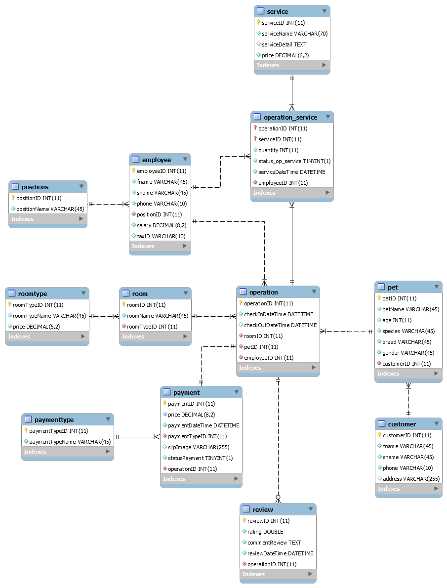

# pet-care-database
MySQL database design and EER diagram for a Pet Daily Care system, created for a 2nd-year university project.
## EER Diagram
Below is the Entity-Relationship Diagram for this project:

*Note: This is my very first database project from Year 2. I kept it here to track my learning progress and improvement over time.*
